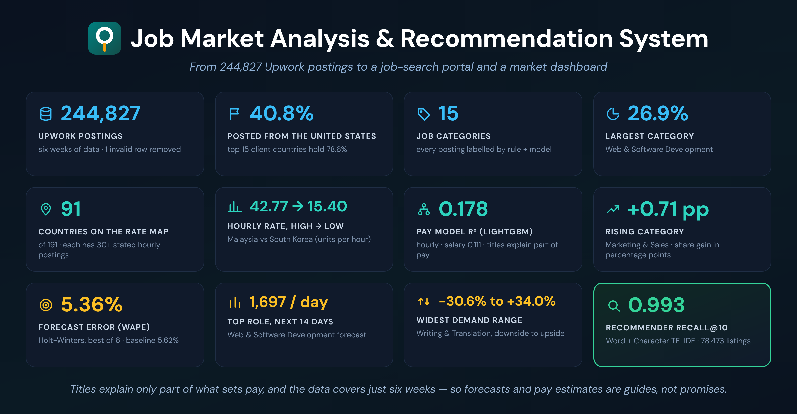

# 🔎 JOB MARKET ANALYSIS & RECOMMENDATION SYSTEM
### *From 244,827 Upwork Postings to a Job-Search Portal and a Market Dashboard*


-orange)


---

### **From Raw Postings to a Job Portal You Can Search**

Freelance and permanent job postings pile up by the thousand every day, and nobody can read them all. This project takes six weeks of Upwork postings, cleans and explores them, models what drives pay, finds which job categories are growing, forecasts which roles will be in demand over the next two weeks, builds four planning scenarios, and then puts the result into **JobLens**, a Streamlit job portal where a job seeker types what they want, chooses a country and gets the best-matching current listings, with a second page of market insights for anyone who wants the numbers behind it.

Rather than stopping at charts, the project answers eight concrete questions about the market (see *Brief Tasks and Where They Are Answered*), compares several models for each prediction, and reports honestly where the data is thin.

---

<p align="center">
  
</p>
<p align="center"><i>The project in twelve numbers — data, method, results and how far to trust them.</i></p>

---

> **⚠️ EVALUATION NOTICE:**
> Full findings, interpretations and model comparisons are in the notebook itself — every analytical
> section closes with an Interpretation block, and the notebook ends with an Executive Summary. A supplementary slide deck
> ([`Job_Market_Presentation_YS.pptx`](./Job_Market_Presentation_YS.pptx))
> covering the key results, the business recommendation and the live app is also included in this repository.

---

## 🔴 Live App

**[JobLens — Find Jobs and Track the Job Market](https://thejoblens.streamlit.app/)**

Type what you are looking for (for example *wordpress developer*), choose your country and press **Find jobs**. Narrow the list by contract type, job category, remote work or stated pay, save the jobs you like, and open any listing on Upwork. Switch to **Market insights** for the weekly dashboard, the pay map and the high-demand roles.

> **Note:** all listings come from postings up to 23 March 2024. Upwork sends closed or removed jobs to its home page, so a link that no longer opens the job means the job has been filled or taken down.

---

## 📌 Project Overview

A job seeker wants to know what is open now, in their country, and what it pays. A recruiter or analyst wants to know what is growing, what pays more and what is likely to be busy next week. Both questions sit in the same data. The question this project answers:

> **Can six weeks of posting titles, countries and pay tell a job seeker where to look — and tell an analyst where the market is heading — without pretending to know more than the data does?**

---

## 🎯 Project Objectives

- Load a large, messy posting file safely (multi-line titles, blank countries, rates not stated) and clean it without silently dropping rows.
- Give **every** posting a job category, using a transparent keyword rule backed by a text model.
- Compare title keywords, job category, country and remote work as drivers of pay, using Freelancer (hourly) and Permanent (salary) pay **separately**.
- Find categories and title themes that are growing or falling, using significance tests instead of eyeballing.
- Forecast daily demand per category with six methods, validate them on rolling windows, and name the high-demand roles.
- Map the average hourly rate by client country.
- Build a country-filtered recommendation engine, evaluate it, and serve it in a job-portal style Streamlit app.
- Summarise the market in a weekly dashboard that updates as new data arrives.
- Analyse remote-work trends and forecast them, and set out four future scenarios.

---

## ❓ Key Questions Answered

1. Which words in a job title go with higher or lower pay?
2. Which job categories and title themes are growing or falling?
3. Which roles will be in highest demand over the next 14 days?
4. Which countries pay the highest and lowest hourly rates?
5. How can a job seeker be matched to current listings in their own country?
6. How does the latest week compare with the weeks before it?
7. How common is remote work, and is it changing?
8. How far could demand move under steady, trending, downside and upside futures?

---

## 🚀 Project Pipeline at a Glance

| Component | Environment | Purpose | Key Output |
|---|---|---|---|
| **job_market_analysis.ipynb** | Google Colab | Loading, cleaning, feature engineering, EDA, pay modelling, trends, forecasting, scenarios, recommender | `recommender_*.pkl`, `dashboard_tables_*.pkl`, figures in `Assets/` |
| **prerequisites.py** | Shared module | Logging, display helpers, colour theme, Local → Drive → GitHub loading and saving | — |
| **job_market_app.py** | Local (VS Code) / Streamlit Cloud | JobLens job portal and market insights | Deployed Streamlit app |

The analysis is a **single notebook** that runs top to bottom in Google Colab. The app does no training: it only loads the two files the notebook saves.

---

## 📂 Dataset Overview

| Property | Detail |
|---|---|
| **Source file** | `all_upwork_jobs.csv` — columns `title`, `link`, `published_date`, `is_hourly`, `hourly_low`, `hourly_high`, `budget`, `country` |
| **Raw postings** | 244,828 (parsed with a line-based parser that rejoins 283 multi-line titles) |
| **After cleaning** | 244,827 (1 posting with a blank title removed) |
| **Contract split** | 140,937 Freelancer (57.57%) / 103,891 Permanent (42.43%) |
| **Time window** | 2 Nov 2023 – 24 Mar 2024; 99.90% of postings fall from 12 Feb 2024 onward (six weeks of real volume) |
| **Client countries** | 212 named countries in the full file; 5,076 postings (2.07%) with no country are labelled `Others` |
| **Countries on the pay map** | 91 (those with at least 30 stated hourly postings) |
| **Current listings (recommender)** | 78,473 unique listings from 10–23 March 2024, across 191 countries |

> **Pay is shown in "units", never dollars, and Freelancer (hourly rate) and Permanent (salary, taken from `budget`) are never pooled.**

---

## 🧹 Data Cleaning & Feature Engineering

- **No row lost to blanks.** Blank countries became `Others`. 38,514 hourly postings without a stated rate were filled with their country's median and stay identifiable through `rate_not_disclosed`; 3,647 with only a lower rate are flagged `open_ended_rate`. Every result can be re-checked on stated pay alone.
- **Titles repaired:** 10,160 titles had HTML entities, odd characters or extra spaces.
- **Remote work from titles:** 1,365 postings (0.56%) are flagged remote from title keywords found in the data itself ("remote", "work from home", "WFH"); phrases like "remote desktop" are excluded. Because only the title is read, this is a lower bound.
- **Job category for every title:** 15 categories. 89.74% are assigned by a keyword rule, 1.76% by a TF-IDF Logistic Regression model (probability ≥ 0.40), and 8.50% are labelled `General / Unspecified` because the title names no recognisable work.
- **Pay columns:** hourly midpoint, pay status, weekday and month, title length, and a repost flag (17,244 postings repeat an earlier title, country, contract and pay exactly; flagged, not removed).
- **Outliers:** pay outliers are capped at an IQR fence on the log scale (hourly rate 1.56% of postings, salary 0.59%) and compared with percentile caps. Capped columns are added next to the originals.

---

## 📊 Exploratory Analysis — Key Findings

- **Three in ten postings are Web & Software Development** (26.90%); the top seven categories hold 88.22% of postings.
- **The United States posts 40.8% of all listings**; the top 15 countries hold 78.6%.
- **Pay is strongly right-skewed:** median hourly rate 22.50 units against a mean of 29.71.
- **Title words move pay a lot.** Among Freelancer postings the median is 92.00 units when the title contains *lawyer* (+309%), 55.00 for *cryptocurrency* (+144%) and 50.00 for *tax* (+122%), but only 7.50 for *virtual* and 6.50 for *va* (−67% and −71%).
- **Highest-paid categories (median):** Legal & Consulting for Freelancer (55.00), HR & Recruiting for Permanent (200.00).
- **Malaysia has the highest average hourly rate (42.77 units), South Korea the lowest (15.40)**, among 91 countries with at least 30 stated hourly postings. More postings do not mean higher pay: the rank correlation between a country's volume and its rate is only 0.19.
- **Remote work is rare in titles:** 0.56% of postings, between 16 and 57 a day.
- **Weekly rhythm:** Thursday is the busiest weekday and Sunday the quietest.

---

## 🧠 Models Built

| Task | Models compared | Chosen by |
|---|---|---|
| Pay (Freelancer and Permanent separately, log pay) | Linear Regression (baseline), Random Forest, **LightGBM** | 5-fold cross-validated R² |
| Job category | Keyword rule, then TF-IDF Logistic Regression | Hold-out agreement 0.981 |
| Title themes | TF-IDF → SVD → KMeans, 20 themes | Silhouette sweep, smallest k within 0.02 of best |
| Daily demand | Seasonal Naive (baseline), Weekday Average, **Holt-Winters**, SARIMA, Linear Regression (calendar), GRU | Lowest WAPE on rolling-origin validation |
| Remote share | Seasonal Naive, **Overall Average**, Last 7 Days Average, Holt-Winters | Lowest MAE |
| Recommender | Word TF-IDF, Character TF-IDF, **Word + Character TF-IDF** | Highest MRR |

---

## 🏆 Results

**Pay prediction.** LightGBM is best for both contracts, with cross-validated R² of **0.178 (Freelancer)** and **0.111 (Permanent)**. Those are modest: titles, category and country explain only part of what sets pay (experience, scope and budget are not in the data). Job category is the most important feature for both.

**Demand forecasting (3 rolling windows of 7 days, 14 categories):**

| Forecasting Model | MAE (postings/day) | RMSE (postings/day) | WAPE (%) |
|---|---|---|---|
| Seasonal Naive (baseline) | 22.63 | 34.79 | 5.62 |
| Weekday Average | 25.47 | 41.96 | 6.32 |
| **Holt-Winters** | **21.61** | **33.89** | **5.36** |
| SARIMA | 32.29 | 55.54 | 8.00 |
| Linear Regression (calendar) | 31.51 | 52.31 | 7.81 |
| GRU | 25.48 | 41.46 | 6.33 |

Holt-Winters wins, but only by 4.67% over simply repeating last week. The GRU and SARIMA do worse on 39 days of history.

**High-demand roles for the next 14 days:** Web & Software Development, Marketing & Sales, Design & Creative, Video & Audio, and Writing & Translation. All six forecasting models find the same top five in all three validation folds (hit rate 100%), so the list does not depend on the model chosen.

**Recommender (2,000 held-out titles, results drawn from the same country):**

| Retriever | Recall@10 | MRR | Category Match@10 |
|---|---|---|---|
| Word TF-IDF | 0.987 | 0.934 | 0.537 |
| Character TF-IDF | 0.990 | 0.947 | 0.543 |
| **Word + Character TF-IDF** | **0.993** | **0.953** | **0.556** |

**Scenarios.** Marketing & Sales is rising (+0.71 percentage points between the halves of the window) and Writing & Translation is falling. Writing & Translation also has the widest uncertainty: −30.6% (downside) to +34.0% (upside) against the steady forecast. The remote share is forecast flat at about 0.55% (0.52%–0.61% range).

---

## ✅ Validation & Honest Limits

- **Six weeks is short.** "Rising" means rising inside this window, not a long-term trend, and the forecasts are fitted on 39 full days.
- **Pay models are weak by nature.** The cross-validated R² of 0.178 and 0.111 say the title alone cannot price a job.
- **Theme boundaries are soft.** Theme stability across three random starts is 0.38 (adjusted Rand index), so themes are descriptive.
- **Remote share is a lower bound,** because only the title is read.
- **The recommender is a text-matching tool.** It ranks by how closely a title matches the words typed, within one country; it does not know the seeker's skills or budget.
- **Links age.** Listings are from March 2024; Upwork redirects postings that have since closed.

---

## 🖥️ The App — JobLens

A Streamlit app that loads the two saved files and trains nothing.

**Find jobs (the main page)**
- A search bar (job title or skills), a country selector and **Find jobs**; six one-click popular searches.
- Filters for contract type (All / Freelancer / Permanent), job category, remote only and pay stated only.
- Each result shows the title, category, contract, remote tag, pay (an hourly rate or a salary, or "Pay not stated"), match percentage, a **NEW** tag for the last days of the data, and **View on Upwork**.
- **☆ Save** keeps jobs in a saved list for the visit, with a CSV download.
- Before anything is searched, the page shows the newest listings of the chosen country.

**Market insights (secondary page)**
- **Market dashboard:** the latest week against earlier weeks, as cards that turn amber when a measure is unusual, and a weekly chart panel.
- **Pay:** interactive world map of average hourly rate, highest and lowest paying countries, title words with the largest pay premium and discount, and what drives pay.
- **High-demand roles:** the roles ranked by forecast demand, with history and a 14-day forecast and interval for any roles you pick.

---

## 🗺️ Brief Tasks and Where They Are Answered

| # | Task | Where in the notebook (heading) | In the app |
|---|---|---|---|
| 1 | Title keywords and pay | Exploratory Data Analysis → *Task 1: Bivariate — Title Keywords vs Pay*; Feature Encoding & Pay Modelling | Market insights → Pay |
| 2 | Emerging job categories | Feature Engineering → *Task 2 — Job Category for Every Title*; Trend Analysis & Theme Discovery | — (notebook and slide deck) |
| 3 | High-demand role prediction | Time Series Forecasting → *Task 3: Demand Forecasting — High-Demand Roles* | Market insights → High-demand roles |
| 4 | Average hourly rate by country (interactive map) | Exploratory Data Analysis → *Task 4: Bivariate — Average Hourly Rate by Country* | Market insights → Pay |
| 5 | Recommendation engine with country filter and UI | Recommendation Engine | Find jobs |
| 6 | Monthly-updating dashboard | Period Aggregation & Dashboard Metrics | Market insights → Market dashboard |
| 7 | Remote-work trends and forecasts | *Task 7: Univariate — Remote and Non-Remote Postings*; *Task 7: Remote Work Forecasting* | — (notebook and slide deck) |
| 8 | Future scenarios | Scenario Analysis | — (notebook and slide deck) |

---

## 🧩 Function Documentation

### `recommend(query, country, contract_type=None, top_n=5, model=recommender)`

Returns the listings that best match a job seeker's text, drawn from one country and, optionally, one contract type. This is the project's recommendation interface; `job_market_app.py` contains an exact copy of it.

| Parameter | Type | Description |
|---|---|---|
| `query` | `str` | What the seeker is looking for, e.g. `"wordpress developer"`. An empty or blank string returns an empty table. |
| `country` | `str` | Client country to search, e.g. `"United States"`. Only listings from this country are scored. `"Others"` covers postings with no country. |
| `contract_type` | `str` or `None` | `"Freelancer"`, `"Permanent"` or `None` for both. |
| `top_n` | `int` | Number of results to return (default 5). |
| `model` | `dict` | The saved recommender: `retriever`, `parts`, `vectorizers`, `matrices` (float32), `listings`. |

**How it works.** The query is turned into the same Word and Character TF-IDF vectors as the listing titles. The cosine similarity of each listing is the dot product of the two (TF-IDF vectors are already L2-normalised), averaged over the two parts. Listings with a score of 0 are dropped, and the rest are sorted from best to worst.

**Returns** a `pandas.DataFrame` with the columns `Rank`, `Title`, `Job Category`, `Contract Type`, `Country`, `Remote`, `Pay Type` (`Hourly rate` or `Salary`), `Pay (units)` (empty when the client stated none), `Similar Postings`, `Match (%)` and `Link`. It returns an empty table, not an error, when the country or contract has no listings or nothing matches.

```python
recommend("wordpress developer", "United States", contract_type="Freelancer", top_n=5)
```

### Saved files

| File | Contents | Used by |
|---|---|---|
| `Assets/models/recommender_<timestamp>.pkl` | `retriever`, `parts`, fitted `vectorizers`, listing `matrices` (float32), `listings` table | `recommend()`, app → Find jobs |
| `Assets/models/dashboard_tables_<timestamp>.pkl` | `tables` (18 result tables) and `meta` (data-through date, period, listing count, retriever) | app → Market insights |

The notebook checks for a saved file before retraining, so a rerun skips the slow steps. The app loads the newest file of each kind.

### Shared helpers in `prerequisites.py`

| Function | Purpose |
|---|---|
| `load_upwork_jobs`, `parse_upwork_lines`, `show_load_report` | Reads the posting file (Local → Google Drive → GitHub) with a line-based parser and prints a load report |
| `save_model_artifact`, `load_latest_model_artifact` | Timestamped saves and loading of the newest saved file |
| `setup_logging` | Run log written to `logs/` |
| `section_header`, `subsection_header`, `info_box`, `success_box`, `warning_box`, `centered_table` | Notebook display helpers |
| `missing_value_audit`, `duplicate_check` | Cleaning audits |
| `iqr_bounds`, `detect_outliers_iqr`, `detect_outliers_zscore`, `outlier_summary` | Outlier detection, on a log scale for pay |

---

## 🗂️ Repository Structure

```text
NHIS_Project8/
│
├── Assets/                                   # Data, figures and saved results
│   ├── all_upwork_jobs.csv                   # Source postings
│   ├── hero_image.png                        # README hero image
│   └── models/                               # recommender_*.pkl, dashboard_tables_*.pkl
│
├── deploy_assets/                            # App runtime files (logos)
│
├── logs/                                     # Run logs written by the notebook                   
│
├── .streamlit/config.toml                    # App theme configuration
│
├── job_market_analysis.ipynb                 # The full analysis (single notebook)
├── Job_Market_Presentation_YS.pptx           # Slide deck
├── prerequisites.py                          # Shared utility module
├── job_market_app.py                         # Streamlit app (JobLens)
│
├── requirements.txt                          # Slim — app deployment only
├── requirements-full.txt                     # Complete — notebook and local development
├── LICENSE
└── README.md
```

---

## 📦 Library Architecture

| Library | Purpose |
|---|---|
| **pandas / numpy / scipy** | Data handling, numerical computing, statistical tests |
| **matplotlib / seaborn** | Notebook visualisation |
| **plotly** | Interactive world map and the app's charts |
| **scikit-learn** | TF-IDF, Logistic Regression, Random Forest, KMeans, SVD, metrics |
| **lightgbm** | Best pay model |
| **statsmodels** | Holt-Winters and SARIMA forecasting |
| **tensorflow / keras** | GRU forecaster |
| **pycountry** | Country names to ISO codes for the map |
| **joblib** | Saving and loading the recommender and dashboard tables |
| **streamlit** | The app |

Exact pinned versions are in `requirements-full.txt` (notebook and local development) and `requirements.txt` (the slimmer set the app needs).

---

## 💻 Installation & Setup

### Step 1 — Run the notebook (Google Colab)

1. Upload `job_market_analysis.ipynb` to Google Colab.
2. `prerequisites.py` downloads itself from GitHub if it is not present. After pushing a new version, restart the Colab session so the new file is used.
3. Data and saved results load through a **Local → Google Drive → GitHub** cascade — no manual setup is needed when running against this repository.
4. Run top to bottom. Saved files are reused on later runs.

### Step 2 — Run the app (local)

The app cannot run inside Colab.

```bash
git clone https://github.com/S-Yousuf-S/NHIS_Project8.git
cd NHIS_Project8
python -m venv JOB_ENV
```

**Windows:** `JOB_ENV\Scripts\activate`
**macOS / Linux:** `source JOB_ENV/bin/activate`

```bash
pip install -r requirements.txt
streamlit run job_market_app.py
```

> The saved recommender is a pickle, so `scikit-learn`, `numpy`, `scipy` and `pandas` in the app environment must match the versions used in Colab when the files were saved. `requirements.txt` pins them.

> `Assets/models/recommender_*.pkl` is about 83 MB. It is under GitHub's 100 MB limit but too large for the web uploader, so push it with `git`.

---

## 🙋 Frequently Asked Questions

### About the app

**Q: What is JobLens, in one sentence?**

**A:** JobLens is a website where you type the kind of job you want, choose your country, and see current job listings that match, plus a second page that shows what is happening in the job market overall.

**Q: Who is it for?**

**A:** Two kinds of people. *Job seekers* use the **Find jobs** page to search listings. *Recruiters, students and analysts* use the **Market insights** page to see what pays more, which roles are busy and how the market moved.

**Q: Where do the jobs come from, and how recent are they?**

**A:** They are real Upwork postings collected for this project. The data runs up to 23 March 2024, so these are not live jobs from today. The project shows how a job-search and market-tracking tool is built; it is not a replacement for Upwork itself.

**Q: How do I search for a job?**

**A:** Type a job title or skill (for example *virtual assistant*), choose your country, and press **Find jobs**. You can also click one of the popular searches. Use the filters on the left to narrow the list by contract type, job category, remote work, or jobs that show their pay.

**Q: What does "Match (%)" mean?**

**A:** It shows how closely the job's title matches the words you typed. A high number means the title is very similar to your search. It does **not** mean you will be hired, and it does not know your skills or experience.

**Q: Why do I only see jobs from one country?**

**A:** You choose a country, and the app searches only that country's listings. The country is the **client's** country (where the person posting the job is), not necessarily where you must work: many Upwork jobs can be done from anywhere.

**Q: What is the difference between "Freelancer" and "Permanent"?**

**A:** *Freelancer* jobs pay by the hour (an hourly rate). *Permanent* jobs pay a fixed amount (a salary). They are shown separately and never averaged together, because an hourly rate and a salary measure different things.

**Q: Why is pay shown in "units" and not dollars?**

**A:** The data does not say which currency the pay is in, so turning it into dollars would mean guessing. "Units" are the numbers exactly as the clients entered them.

**Q: Why does a job say "Pay not stated"?**

**A:** Some clients leave the pay blank. The app only shows pay when the client actually wrote it down; it never invents a number for a single job.

**Q: What does the "NEW" tag mean?**

**A:** The job was posted in the last few days of the data (not in the last few days of today's calendar).

**Q: What does the "Remote" tag mean, and why are so few jobs marked remote?**

**A:** A job is tagged remote when its title says so, for example "remote" or "work from home". Only about 1 posting in 180 (0.56%) says this in its title. Many other jobs can also be done remotely without saying it in the title, so the real share is higher.

**Q: I clicked "View on Upwork" and landed on Upwork's home page. Is something broken?**

**A:** No. The jobs are from February and March 2024. When Upwork closes or removes a job, it sends visitors to its home page instead. That tells you the job has been filled or taken down.

**Q: What does "☆ Save" do?**

**A:** It adds the job to a *Saved jobs* list at the top of your results so you can come back to it and download the list as a CSV file. The list lasts while you keep the page open; refreshing the page clears it. The app has no accounts and stores nothing about you.

**Q: Can I apply for a job inside the app?**

**A:** No. Applying happens on Upwork, so the app sends you there through **View on Upwork**.

**Q: Does the app keep my searches or personal details?**

**A:** No. There are no accounts and no database. Your searches are used only to show your results during that visit.

**Q: Why does the app take a moment to open the first time?**

**A:** The app "goes to sleep" when nobody has used it for a while and loads its saved data (about 83 MB) when it wakes. After that, searches are quick.

### The Market insights page

**Q: What is on the Market dashboard?**

**A:** Cards that compare the latest week with the weeks before it — for example postings per day, the share of freelance jobs and the average hourly rate. A **green** card means the number is within its usual range. An **amber** card means this week was higher or lower than usual and is worth a closer look.

**Q: How do I read the world map?**

**A:** Each coloured country shows its average hourly rate, from blue (lower) to red (higher). Hover over a country to see its average, its median and how many postings it is based on. Countries with fewer than 30 postings that state an hourly rate are left out, so they appear blank.

**Q: Which countries pay the most and the least?**

**A:** Among the 91 countries on the map, Malaysia has the highest average hourly rate (42.77 units) and South Korea the lowest (15.40 units). More postings does not mean higher pay: a country with many postings is not necessarily a high-paying one.

**Q: What do the percentages next to words like "lawyer" or "virtual" mean?**

**A:** They compare pay between jobs whose title contains the word and jobs whose title does not. For example, hourly jobs with *lawyer* in the title have a median rate about 309% higher than those without it, while jobs with *virtual* are about 67% lower. It shows a pattern in the titles; it does not mean the word itself causes the pay.

**Q: What are "high-demand roles"?**

**A:** The five job categories expected to have the most postings per day over the next 14 days: Web & Software Development, Marketing & Sales, Design & Creative, Video & Audio, and Writing & Translation. They are based on a forecast from the recent daily number of postings.

**Q: How accurate are the forecasts?**

**A:** The best method (Holt-Winters) was off by about 5 postings in every 100 when tested on weeks it had not seen (5.36%). That is good for planning but not a promise. The shaded band on the forecast chart shows the range in which real days usually land.

**Q: How accurate is the pay model?**

**A:** Only partly. A job title, its category and its country can explain roughly 18% of the differences in hourly pay and 11% of the differences in salary. Things that really set pay — the freelancer's experience, the size of the project — are not in the data. Treat any pay estimate as a rough guide.

**Q: Why is only six weeks of data used? Can I trust the trends?**

**A:** Almost all postings in the file fall in six weeks (12 February to 23 March 2024). That is enough to see the weekly rhythm and short-term movement, but not a long-term trend. When the project says a category is "rising", it means rising within these six weeks.

**Q: How does each job get a category?**

**A:** First, a list of keywords decides it (for example, a title with "logo" goes to Design & Creative). If no keyword fits, a text model suggests a category when it is confident. If nothing fits, the job is labelled *General / Unspecified* rather than forced into a wrong group.

**Q: Why did a simple method beat the neural network for forecasting?**

**A:** There are only 39 full days of history. A neural network needs a lot more data to learn from; a simple method that follows the level and the weekly pattern did better on this small amount.

### Using it responsibly

**Q: Can I rely on this to decide my career or my hiring?**

**A:** No. It is a learning project. The jobs are from 2024, pay is partly missing, and the forecasts rest on six weeks of data. Use it to explore ideas, and check the original source before you decide anything important.

**Q: Which languages does it work with?**

**A:** It works best with English job titles and search words. Titles in other languages can be searched, but the matching and job categories are built around English words, so results may be weaker.

### Running it yourself

**Q: Can I run the project on my own computer?**

**A:** Yes. See *Installation & Setup* above. In short: clone the repository, install `requirements.txt`, and run `streamlit run job_market_app.py`.

**Q: Why can't I run the app in Google Colab?**

**A:** A Streamlit app needs its own web server. Run the notebook in Colab, and run the app on your own computer or on Streamlit Cloud.

**Q: Do I need a graphics card (GPU)?**

**A:** No. Everything runs on a normal computer.

**Q: Where are the saved model files?**

**A:** In `Assets/models`. The notebook creates two files there (`recommender_*.pkl` and `dashboard_tables_*.pkl`) and the app loads them. The recommender file is about 83 MB, so it must be pushed to GitHub with `git`, not the web uploader.

---

## 📌 Conclusion

This project takes a large, messy posting file to a working job portal and an honest market view. Every title has a category, pay is modelled separately for freelance and permanent work, growing categories are tested rather than guessed, demand is forecast and validated, and the recommender finds the right listing in the top ten for 99.3% of held-out titles.

**Final verdict:** LightGBM is the best pay model, Holt-Winters is the best forecaster, and Word + Character TF-IDF is the best retriever — each with limits that the project states: a six-week window, a weak pay signal in titles, and a lower-bound remote share.

---

## 🚀 Future Scope

- Refresh the data monthly so the dashboard's "latest week against earlier weeks" gains real history, and re-test the growing and falling categories over a longer window.
- Add the information that actually sets pay (experience level, project scope, client history) to lift the pay model beyond its current R².
- Let a job seeker upload a CV or skills list and match on skills, not only title words.
- Add user accounts so saved jobs and applications persist between visits.
- Repeat the forecasts with several months of data and re-compare the GRU.

---

## 📜 License & Acknowledgements

This project's own code and notebook are released under the **MIT License** (see [`LICENSE`](./LICENSE)).

| Component | Used for | Licence |
|---|---|---|
| **Open-source libraries** (scikit-learn, LightGBM, statsmodels, TensorFlow, Plotly, Streamlit, and others) | Modelling and the app | Each library's own licence (mostly BSD, MIT or Apache 2.0) |
| **Upwork postings dataset** (`all_upwork_jobs.csv`) | Analysis and recommendations | Supplied with the project brief of the NHIS data science programme |

The postings belong to their original authors and are used here only for learning and evaluation. JobLens is a learning project, not a hiring service, and listings are not hiring advice.

---

# 👤 Author

**Yousuf S. R. Sakkaf**

**GitHub:** [https://github.com/S-Yousuf-S](https://github.com/S-Yousuf-S?tab=repositories)

---

⭐ *If you found this project helpful or insightful, consider giving the repository a star.*
